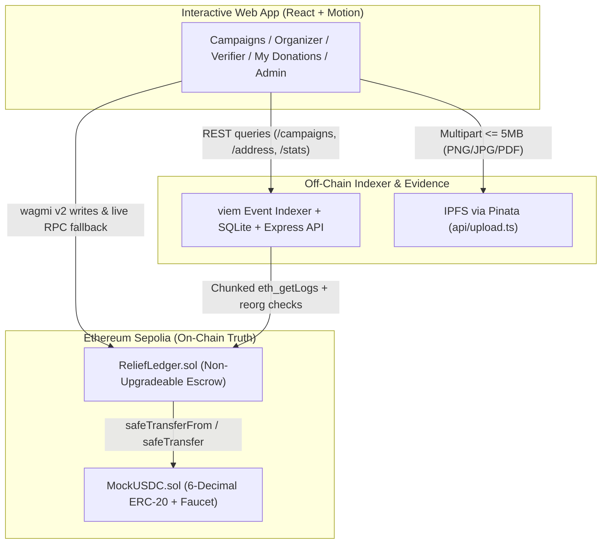

# ReliefLedger

> **⚠️ Testnet prototype. Not audited. No real funds.**  
> Sepolia disaster-relief escrow built with Solidity 0.8.24, Foundry, custom `viem` SQLite Indexer, React 19, RainbowKit, and Motion.

---

## Problem & Core Guarantee

Traditional charity disbursements lack post-donation accountability: once donors send funds, platforms or coordinators hold unilateral custody. **ReliefLedger** replaces intermediary custody with campaign-isolated smart contract escrow:

- **No Admin Extraction:** Contract owner cannot withdraw, redirect, or sweep donor funds—even while paused.
- **Allowlisted Vendors Only:** Funds pay pre-vetted supplier addresses directly (`vendor != organizer`, `vendor != verifier`).
- **M-of-N Verifiers + Single-Verifier Veto:** Every vendor payout requires strict majority verifier approval followed by an immutable 24h–7d challenge cooldown where **any** verifier can veto suspicious invoices.
- **Three Pull-Based Refund Guards:** Donors claim pro-rata USDC directly if (1) minimum fundraising goal fails, (2) organizer stalls past `stallTimeout` (14–90 days), or (3) leftover funds remain after final delivery.

---

## System Architecture



### Campaign Lifecycle State Machine

```mermaid
stateDiagram-v2
    [*] --> Fundraising: createCampaign()
    Fundraising --> Active: finalizeFundraising() [raised >= minGoal]
    Fundraising --> Refunding: finalizeFundraising() [raised < minGoal]
    Active --> Active: proposePayout() -> approvePayout() -> executePayout() -> submitDelivery()
    Active --> Refunding: triggerStallRefund() [now > lastProgressAt + stallTimeout]
    Active --> Completed: submitDelivery() [last milestone; unspent -> refundPool]
    Refunding --> Refunding: claimRefund() (pro-rata)
    Completed --> Completed: claimRefund() (if refundPool > 0)
```

---

## Roles & Capabilities Matrix

| Role | Permitted Actions | Explicitly Forbidden |
|---|---|---|
| **Donor** | Donate >= `1 USDC`, call `claimRefund` (even if paused), trigger permissionless `finalizeFundraising` / `triggerStallRefund` / `executePayout` | Donations after deadline |
| **Organizer** | Propose vendor payout up to `currentAvailable`, cancel own request, submit delivery proof | Direct wallet withdrawals, self-payment, exceeding milestone cap |
| **Verifier (3–9)** | Approve up to threshold, unilaterally `vetoPayout(requestId, reasonCid)` before execution (even if paused) | Receiving payouts as vendor, approving twice |
| **Vendor** | Receive direct USDC payouts upon `executePayout` | Self-approving requests |
| **Admin (`owner`)** | `setVendor`, `createCampaign`, `pause`/`unpause`, 2-step `transferOwnership` | Withdrawing/moving escrowed funds, changing live campaign params (`renounceOwnership` reverts) |

---

## Sepolia Deployment Status

No pre-funded deployment key is included in this repository. Contract addresses are populated cleanly via deployment artifacts:

- [`contracts/deployments/sepolia.json`](contracts/deployments/sepolia.json) — placeholder (`0x0000...0000`) until [`Deploy.s.sol`](contracts/script/Deploy.s.sol) is broadcast with a Sepolia key.
- Both `indexer/` and `web/` automatically read deployment artifacts or `.env` overrides; when `web` sees zero/unconfigured addresses or no running indexer, it shows explicit setup guidance and supports direct on-chain RPC inspection.

---

## Quickstart & Local Verification

### 1. Smart Contracts (`contracts/`)

```bash
cd contracts
forge fmt --check
forge build
forge test -vv
forge coverage --ir-minimum --report summary
```

Observed suite metrics (`contracts/src/ReliefLedger.sol`):
- **28 / 28 tests pass** (21 unit tests, 3 fuzz tests x 256 runs, 4 stateful invariant suites x 12,800 calls each with 0 reverts)
- **99.17% line coverage (238/240)** and **97.47% branch coverage (77/79)** on `ReliefLedger.sol`

### 2. Event Indexer (`indexer/`)

```bash
cd indexer
npm install
npm run typecheck
npm run build
# Optional runtime & drift check against a live RPC:
# npm run dev
# npm run reconcile
```

### 3. Frontend (`web/`)

```bash
cd web
npm install
npx tsc --noEmit
npm run build
npm run dev
```

---

## Security & Documentation

- Architecture & Gas Snapshots: [`docs/ARCHITECTURE.md`](docs/ARCHITECTURE.md) ([`.gas-snapshot`](contracts/.gas-snapshot))
- Threat Model: [`docs/THREAT_MODEL.md`](docs/THREAT_MODEL.md)
- Trust Assumptions & Limitations: [`docs/TRUST_ASSUMPTIONS.md`](docs/TRUST_ASSUMPTIONS.md)
- Decision Log (ADRs): [`docs/DECISIONS.md`](docs/DECISIONS.md)
- Demo Guide: [`docs/DEMO.md`](docs/DEMO.md)

---

## Author & License

- **Owner / Author:** Nur Hidayat Surya Pamungkas
- **License:** Licensed under the [MIT License](LICENSE).

---

## Deliberately Out of Scope (v2 Roadmap)

- Upgradeable proxies & governance tokens
- Donor voting or post-deadline top-ups
- Verifier staking/slashing/random committee rotation
- On-chain KYC, fiat on/off-ramps, multi-token/ETH deposits, account abstraction, and mainnet deployment
