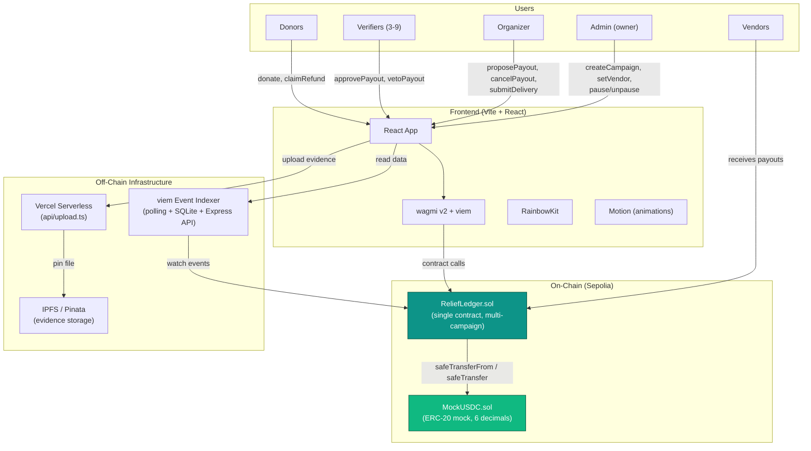
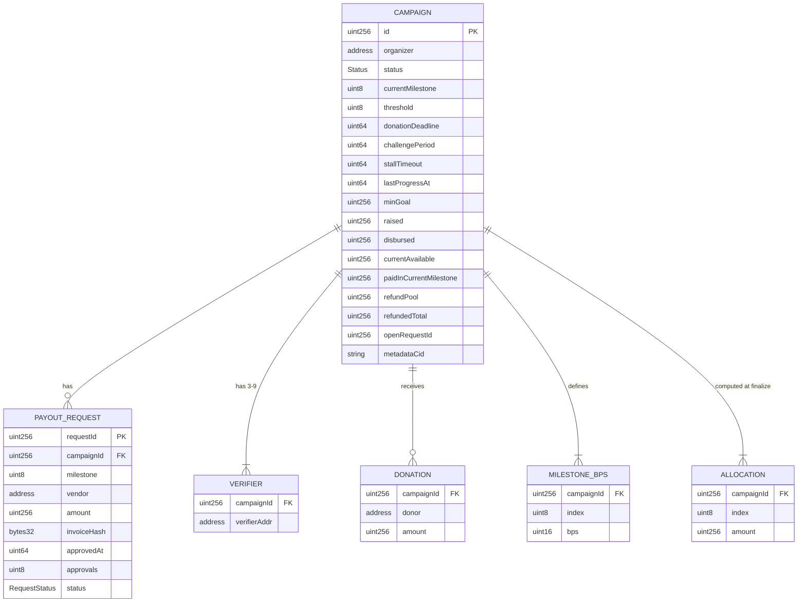
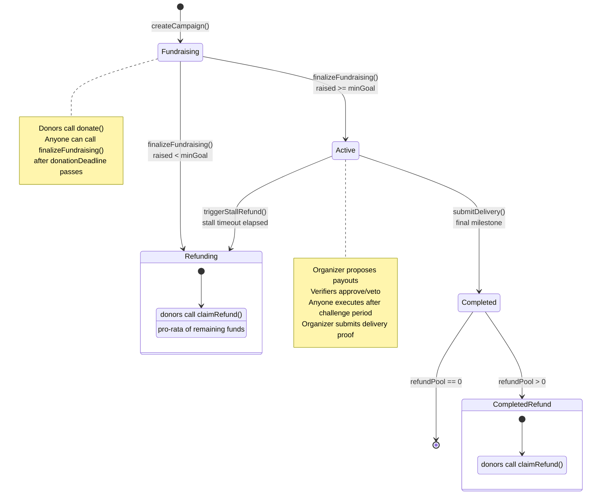
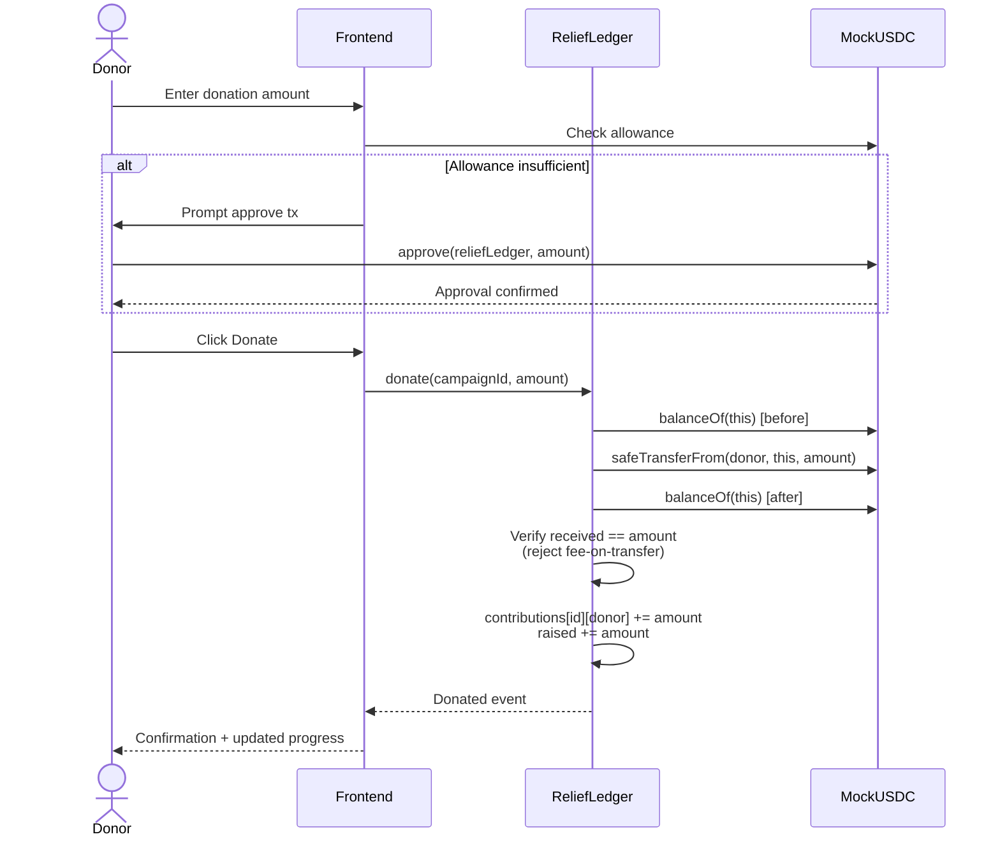
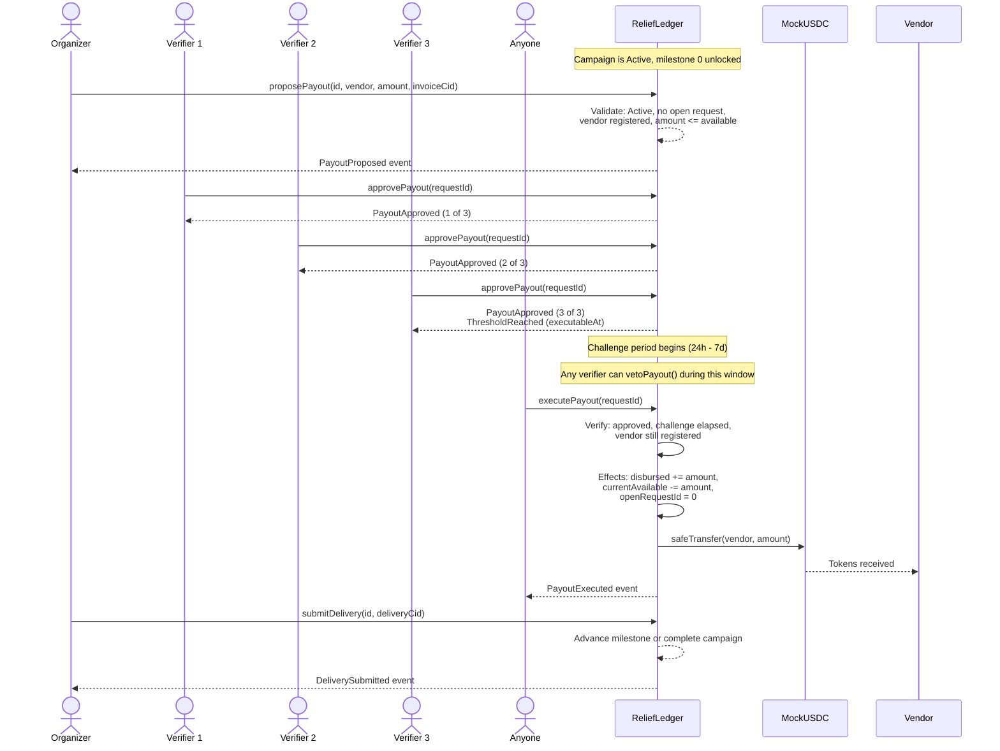
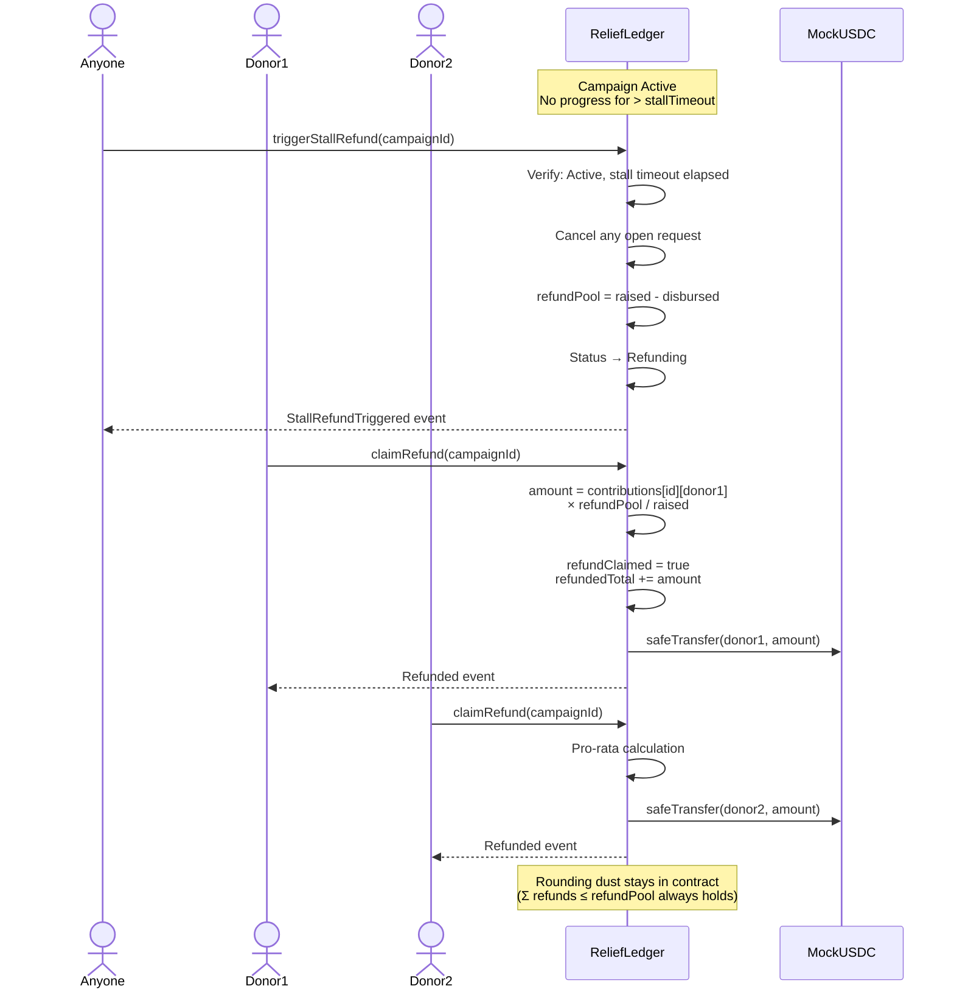
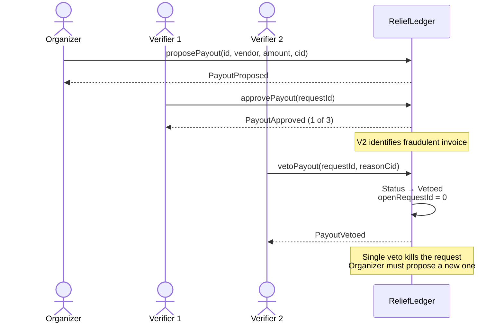

# ReliefLedger — Architecture

> **Version:** 1.0 · Testnet Prototype (Sepolia)

## Table of Contents

- [System Overview](#system-overview)
- [Component Diagram](#component-diagram)
- [Data Model](#data-model)
- [State Machine](#state-machine)
- [Sequence Diagrams](#sequence-diagrams)
- [Gas Considerations](#gas-considerations)
- [Design Decisions](#design-decisions)

---

## System Overview

ReliefLedger is a milestone-based disaster-relief escrow built on Ethereum (Sepolia testnet). A single non-upgradeable smart contract (`ReliefLedger.sol`) manages many independent campaigns. Funds flow **only** through two code-enforced paths — payout to a registered vendor after verifier approval, or pro-rata refund to donors — guaranteeing that no party, including the contract owner, can extract escrowed funds.

The stack is intentionally simple:

| Layer | Technology | Role |
|---|---|---|
| Smart Contracts | Solidity 0.8.24, Foundry, OpenZeppelin v5 | Source of truth; escrow, state machine, access control |
| Mock Stablecoin | `MockUSDC` (ERC-20, 6 decimals) | Testnet-only donation token |
| Indexer | Custom TypeScript (`viem` + Express + SQLite) | Event-driven read model with reorg check & REST API |
| Frontend | Vite + React + TypeScript, wagmi v2, RainbowKit, Motion | User interface |
| Evidence Storage | IPFS via Pinata (server-side upload) | Invoice and delivery proof storage |
| Hosting | Vercel | Frontend + serverless upload function |

---

## Component Diagram

---

## Data Model

### Core Structures

### Storage Mappings

| Mapping | Key(s) | Value | Purpose |
|---|---|---|---|
| `campaigns` | `id` | `Campaign` struct | Campaign state |
| `bps` | `id` | `uint16[]` | Milestone percentage allocations (basis points) |
| `allocations` | `id` | `uint256[]` | Actual token amounts per milestone (computed at finalize) |
| `verifiers` | `id` | `address[]` | Verifier list per campaign |
| `isVerifier` | `id`, `addr` | `bool` | Fast verifier lookup |
| `contributions` | `id`, `addr` | `uint256` | Per-donor contribution tracking |
| `refundClaimed` | `id`, `addr` | `bool` | Prevents double refund claims |
| `requests` | `requestId` | `PayoutRequest` | Payout request state |
| `hasVoted` | `requestId`, `addr` | `bool` | Prevents double voting |
| `isVendor` | `addr` | `bool` | Global vendor registry |

### Enums

| Enum | Values | Notes |
|---|---|---|
| `Status` | `Fundraising → Active → Completed / Refunding` | Monotonic; terminal states never change |
| `RequestStatus` | `None, Proposed, Vetoed, Cancelled, Executed` | Per payout request |

---

## State Machine

### Transition Rules

| From | To | Trigger | Condition |
|---|---|---|---|
| `Fundraising` | `Active` | `finalizeFundraising()` | `block.timestamp >= donationDeadline` AND `raised >= minGoal` |
| `Fundraising` | `Refunding` | `finalizeFundraising()` | `block.timestamp >= donationDeadline` AND `raised < minGoal` |
| `Active` | `Refunding` | `triggerStallRefund()` | `block.timestamp > lastProgressAt + stallTimeout` |
| `Active` | `Completed` | `submitDelivery()` | Final milestone delivery proof submitted |

> **Key invariant:** Status transitions are **monotonic** — no state ever moves backwards. `Completed` and `Refunding` are terminal.

---

## Sequence Diagrams

### Donation Flow

### Payout Lifecycle

### Stall Refund

### Veto Flow

---

## Gas Considerations

### Design Choices for Gas Efficiency

| Decision | Gas Impact | Rationale |
|---|---|---|
| Single contract (no proxies) | Lower per-call overhead | No delegatecall cost; simpler storage layout |
| Store CID hashes, emit full CIDs | ~20k gas saved per write vs storing strings | Events are cheaper than storage; full CIDs available in logs |
| Bounded arrays (max 9 verifiers, max 5 milestones) | Predictable loop gas | Prevents unbounded iteration; worst case is known |
| Pull-based refunds | O(1) per claim | Never loops over donors; each donor pays their own gas |
| Single `openRequestId` per campaign | No array scanning | Only one payout request active at a time |
| `uint64` for timestamps | 8 bytes vs 32 | Adequate for timestamps; tighter struct packing |

### Measured Gas Snapshots (`forge snapshot`)

Full gas numbers are tracked in [`.gas-snapshot`](../contracts/.gas-snapshot), generated via `forge snapshot`. Representative test-suite measurements (including setup + assertions per test case):

| Test Suite Scenario | Measured Gas |
|---|---|
| `test_CreateCampaign_Happy` | 508,433 |
| `test_Donate_HappyAndReverts` | 574,523 |
| `test_Approve_Challenge_Execute_Boundaries` | 865,219 |
| `test_VetoDuringChallengePeriod_AndCancel_EvenWhenPaused` | 932,125 |
| `test_FullLifecycle_MultiMilestone_WithLeftoverRefund` | 1,435,999 |
| `test_GoalNotMet_FullRefund_EvenWhenPaused` | 646,710 |
| `test_StallRefund_AfterPartialDisbursement_CancelsOpenRequest` | 1,181,147 |
| `test_SetVendor_HappyAndEvents` | 35,915 |
| `test_PauseUnpause_AccessControl` | 37,495 |

---

## Design Decisions

### Why No Upgradeability

The contract is intentionally non-upgradeable:

- **Trust:** Donors need assurance that the escrow rules cannot be changed after they deposit funds. An upgradeable proxy means a proxy admin could rewrite the contract to drain the escrow.
- **Simplicity:** Proxy patterns (UUPS, Transparent) add attack surface — storage collisions, initializer bugs, unprotected `upgradeTo` calls — without proportionate benefit for a testnet prototype.
- **Immutable guarantees:** Campaign parameters are fixed at creation. Combined with a non-upgradeable contract, this means the rules under which a donor contributed can never change.

> **Trade-off:** Bug fixes require deploying a new contract and migrating campaigns. Acceptable for a testnet prototype; a production system might use a timelock-guarded proxy with explicit donor consent for migrations.

### Why Single-Veto Power

Any single verifier can veto a payout request, killing it immediately:

- **Conservative by design:** In disaster relief, false positives (blocking a legitimate payout) are recoverable — the organizer re-submits with better evidence. False negatives (allowing a fraudulent payout) are irrecoverable — funds are gone.
- **Stall protection:** A malicious verifier who abuses veto power is bounded by the stall timeout. After `stallTimeout` with no progress, anyone can trigger `triggerStallRefund()` and donors get their remaining funds back.
- **Simplicity:** Multi-veto thresholds add complexity (who can override? what if veto count < threshold?) without clear benefit when stall refund already caps downside.

> **Trade-off:** A single griefing verifier can delay payouts by up to `stallTimeout`. This is documented in the Threat Model (Threat #5).

### Why Fixed Fundraising Window

Donations are only accepted during a fixed window (`donationDeadline`):

- **Predictable accounting:** The allocation split is computed once at `finalizeFundraising()`. Allowing donations after finalization would require re-computing all milestone allocations.
- **Clear lifecycle:** Donors know exactly when fundraising ends. The campaign either meets its goal or fails cleanly.
- **Prevents manipulation:** Without a fixed window, late donations could be used to dilute earlier donors' refund shares or change milestone allocations mid-campaign.

> **Trade-off:** Legitimate late donors cannot contribute. This is listed as an out-of-scope roadmap item.

### Why `Ownable2Step` (Not Direct Ownership Transfer)

Two-step ownership transfer prevents accidental loss of admin control:

1. Current owner calls `transferOwnership(newOwner)` — sets pending owner.
2. New owner calls `acceptOwnership()` — confirms the transfer.

If the wrong address is specified in step 1, no harm is done because step 2 will never succeed. Combined with `renounceOwnership` reverting, the contract always has an admin who can create campaigns and manage vendors.

### Why `lastProgressAt` Updates Are Restricted

Only three functions update `lastProgressAt`: `finalizeFundraising`, `executePayout`, and `submitDelivery`. This bounds how long an organizer can delay the stall timeout:

- An organizer cannot reset the stall clock by simply proposing payouts or submitting empty deliveries.
- Maximum delay is bounded: at most `2 × number_of_milestones` progress resets before funds are fully disbursed or the campaign completes.
- This ensures the stall refund mechanism remains a credible threat to negligent organizers.
